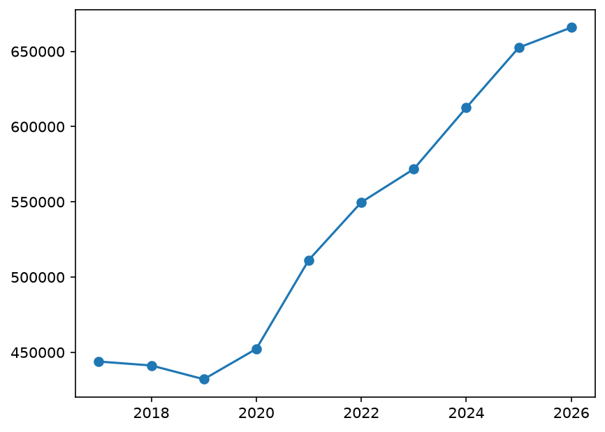
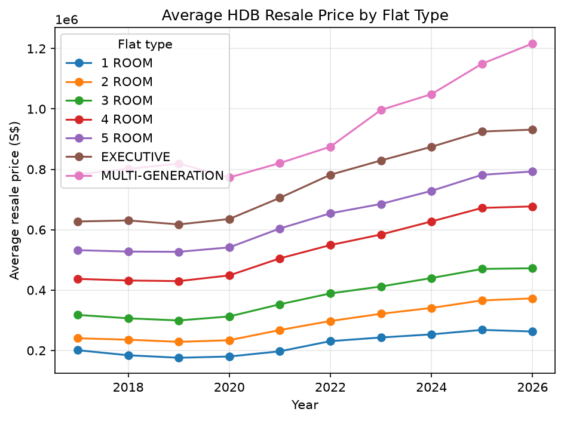
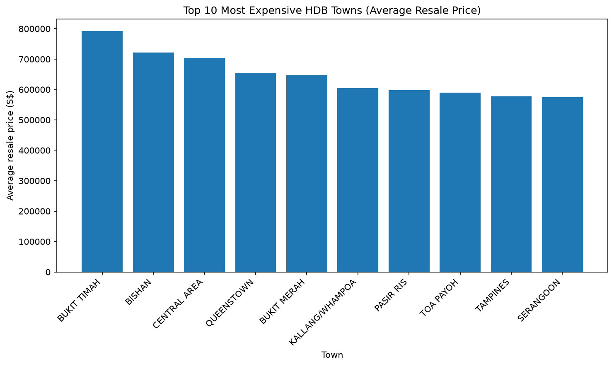
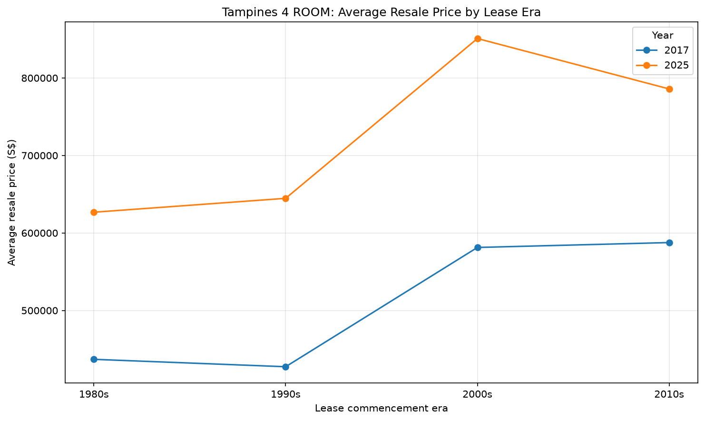

# HDB Resale Price Analysis (2017 to 2026)

A data analysis project using **pandas**, **NumPy** and **matplotlib** on Singapore's public HDB resale flat transaction data.

## Question

> How have HDB resale prices changed across towns since 2017, and how much do flat type and remaining lease matter?

## Data

- **Source:** [Resale flat prices based on registration date from Jan-2017 onwards](https://data.gov.sg/datasets/d_8b84c4ee58e3cfc0ece0d773c8ca6abc/view) on data.gov.sg, published by HDB under the Singapore Open Data Licence.
- **Columns used:** month, town, flat_type, floor_area_sqm, lease_commence_date, remaining_lease, resale_price.
- The raw data file is not included in this repository. Download the CSV from the link above and save it in the project folder as `HDB_resale_price_data.csv`.

## Results

### 1. Prices over time

Across all flat types, the average resale price was about S$444,000 in 2017, dipped slightly to about S$432,000 in 2019, then rose steadily to roughly S$666,000 by 2026. That is an increase of about 50% from 2017. The sharpest jump came between 2020 and 2021. Note that 2026 only includes data up to September.

### 2. Prices by flat type

Every flat type follows the same pattern: flat or slightly falling prices from 2017 to 2019, then growth from 2020 onwards. Larger flats cost more at every point, and the gaps widened over time. 4 ROOM flats rose from about S$437,000 to about S$677,000. MULTI-GENERATION flats show the biggest rise (from about S$785,000 to about S$1.2 million), but they have very few sales each year, so that line is less reliable.

### 3. Most expensive towns

Averaged over all years and flat types, Bukit Timah (about S$790,000), Bishan and Central Area are the most expensive towns. Tampines sits ninth. These averages mix flat types, so a town with more large flats will look more expensive, and this chart should not be read as a like-for-like comparison.

### 4. Price growth by town (4 ROOM only)

To compare towns fairly, this chart uses only 4 ROOM flats and compares 2017 with 2025. Sembawang grew fastest (about 80%), followed by Woodlands, Hougang, Pasir Ris and Yishun (roughly 60 to 63%). The slowest growth was in Marine Parade (about 25%), Bukit Timah, Jurong East, Bukit Merah and Bishan. Many of the slowest-growing towns were already among the most expensive, which suggests that prices in cheaper towns caught up somewhat. Towns with few 4 ROOM sales (such as Marine Parade and Bukit Timah) can swing a lot, so their results are less certain. Tampines grew about 56%.

### 5. Does lease age matter? (Tampines, 4 ROOM)

Flats with newer leases (2000s and 2010s) cost more than older ones in both years. Growth from 2017 to 2025 was roughly 43% for 1980s leases, 51% for 1990s leases, 46% for 2000s leases and 34% for 2010s leases.

My hypothesis was that older leases would grow more slowly, because buyers worry as the lease runs down. The data does not support that. The 1990s group grew fastest and the 2010s group slowest. One possible reason is that older flats started from a lower price, so the same increase in dollars is a larger percentage.

## Limitations

- The lease era analysis covers one town and one flat type, so the results may not apply elsewhere.
- Some groups have few sales, which makes their averages less reliable.
- Prices are affected by many things not in this dataset, such as floor level, renovation condition and market cycles. The results show associations, not proof that lease length causes price changes.
- The 2017 to 2025 window is one choice of period, and other windows could give different results.
- 2026 is a partial year (data to September), so it is not directly comparable with full years.

## Tools

Python, pandas, NumPy, matplotlib.
